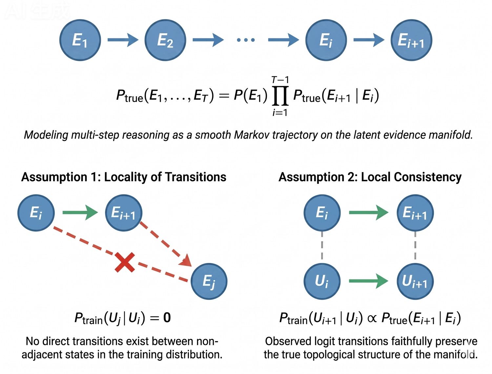
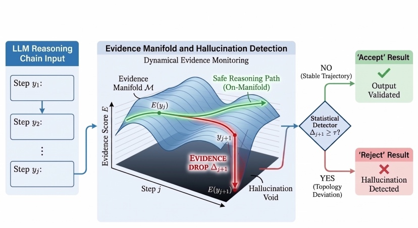
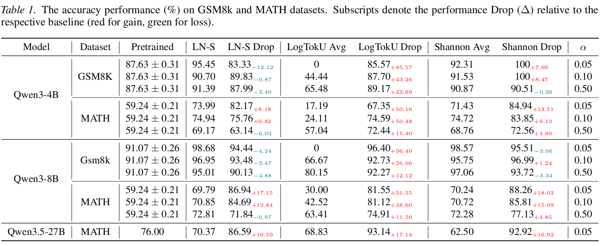
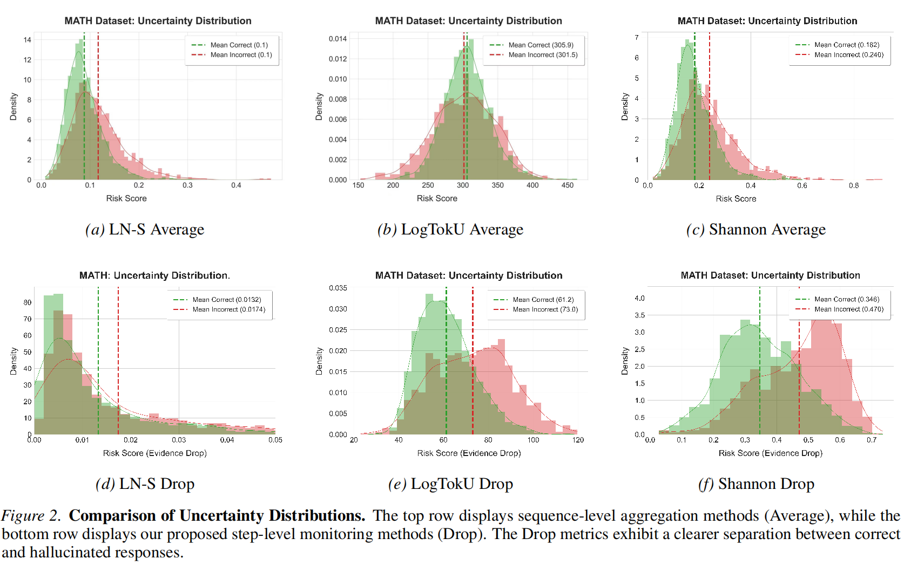

<div align="center">

<h1>Mind the Gap</h1>
<h3>Catching Hallucinations via Evidence Drop on the Reasoning Manifold</h3>

<p>Qunjie Chen · Yufei Chen · Xiaodong Yue · Linye Li</p>

<p><b>ICML 2026</b> · <a href="https://proceedings.mlr.press/v306/chen26n.html">Paper</a> · <a href="https://openreview.net/forum?id=gllCfOG1Gt">OpenReview</a> · <a href="#quickstart">Quickstart</a> · <a href="#results">Results</a> · <a href="#citation">Citation</a></p>

</div>

A reasoning trace can have low average uncertainty even when one step goes wrong. Evidence Drop measures abrupt losses of token-level support and uses a calibrated hypothesis test to decide when to abstain. It uses the model's token log probabilities and requires no fine-tuning.

## Why evidence drops?

The paper models valid reasoning as a sequence of local transitions on a latent evidence manifold. **Locality of transitions** limits reasoning to adjacent evidence states, and **local consistency** connects those transitions to the model's observable token distributions. An off-manifold jump can produce a sharp loss of support even if the overall trace looks confident.

<p align="center"></p>

## Method

<p align="center"></p>

1. Use batched vLLM inference to generate reasoning traces and collect token log probabilities.
2. Convert the trace to a risk score. For the Drop variants, smooth the evidence curve and aggregate its worst local decreases.
3. Calibrate on incorrect final answers in the calibration split, then apply the fixed threshold to test predictions.

Under the paper's hypothesis test, the null is an unreliable trace. The release uses incorrect final answers as the benchmark proxy for that null. For a fixed model and scorer, the binomial order-statistic rule targets a false acceptance rate of at most `alpha` with confidence `1 - delta`, assuming the incorrect calibration scores are independent draws from the deployment null distribution. The implementation accepts only when `risk < threshold` so ties at the threshold abstain. With insufficient null examples to certify an order statistic, it abstains on every test example. Selective accuracy measures the fraction of accepted answers that are correct.

## Quickstart

Use Python 3.11 on Linux with a CUDA-enabled NVIDIA GPU. The release requirements pin vLLM 0.10.2. See the [vLLM GPU installation guide](https://docs.vllm.ai/en/v0.10.2/getting_started/installation/gpu.html) for platform-specific PyTorch and CUDA instructions.

```bash
git clone https://github.com/QJ0114/evidence-drop.git
cd evidence-drop
python3.11 -m venv .venv
source .venv/bin/activate
python -m pip install -r requirements.txt
```

Set `--model` to [Qwen/Qwen3-4B](https://huggingface.co/Qwen/Qwen3-4B) or [Qwen/Qwen3-8B](https://huggingface.co/Qwen/Qwen3-8B) to download and cache the checkpoint on first use. To download it beforehand and run from a local directory, use:

```bash
hf download Qwen/Qwen3-4B --local-dir models/Qwen3-4B
# Then pass --model ./models/Qwen3-4B.
```

Run calibration and test in one command:

```bash
CUDA_VISIBLE_DEVICES=0 python -m hypothesis_testing.inference \
  --dataset gsm8k \
  --model Qwen/Qwen3-4B \
  --method shannon-drop \
  --alpha 0.05 --delta 0.1 \
  --tensor_parallel_size 1 \
  --output-dir runs/gsm8k-qwen3-4b-shannon-drop-a005
```

Use `--dataset math` for MATH. For a multi-GPU run, expose the GPUs through `CUDA_VISIBLE_DEVICES` and set `--tensor_parallel_size` accordingly. The default scorer settings are 20 top log probabilities, EMA span 5, and five worst drops. The generation length, vLLM scheduling, and memory settings are exposed in `--help`.

| Output | Contents |
| --- | --- |
| `calibration-scores.json` | Scores and correctness labels for calibration |
| `threshold.json` | Threshold, order statistic, significance level, and null sample count |
| `test-scores.json` | Held-out scores and correctness labels |
| `metrics.json` | Accuracy, coverage, selective accuracy, false acceptance and rejection rates, and AURC |

You can rerun the statistical stage with a different significance level using the cached score files and SciPy, without loading vLLM or the model:

```bash
RUN=runs/gsm8k-qwen3-4b-shannon-drop-a005
python -m hypothesis_testing \
  --calibration "$RUN/calibration-scores.json" \
  --test "$RUN/test-scores.json" \
  --alpha 0.10 --delta 0.1
```

## Data and extensions

| Benchmark | Calibration | Held-out test |
| --- | ---: | ---: |
| MATH | 2,500 | 2,500 |
| GSM8K | 660 | 659 |

The [data directory](data/) contains the original split membership, source notices, and checksums. The runner reads the compressed JSONL directly.

- **Other uncertainty measures.** Use `--method` to select `ln-s`, `ln-s-drop`, `logtoku`, `logtoku-drop`, `shannon`, or `shannon-drop`. For a custom token-based measure, use `--scorer my_module:risk`. The callable takes vLLM's per-token log-probability mappings and returns a finite scalar whose larger values indicate higher risk. For scores from an external system, pass separate JSON arrays of `{"risk_score": 0.12, "is_correct": 1}` records to `python -m hypothesis_testing`.
- **Other models.** Use a vLLM-supported Hugging Face model ID or model directory that exposes token log probabilities. The shipped prompts are plain-text few-shot prompts. If a model needs a chat template, adapt the prompt formatter and regenerate both splits before recalibrating.

The runnable evaluation here covers selective prediction on MATH and GSM8K. See the paper for the separate ProcessBench localization protocol and its results.

## Results

<p align="center"></p>

Table 1 reports selective accuracy at the specified significance levels. For example, on MATH with Qwen3-8B at `alpha = 0.05`, Shannon Drop reached **88.26%**, compared with **70.24%** for Shannon Avg. The figure shows the published values. The release calibrator uses the largest eligible order statistic and a strict cutoff. This can change the set of accepted answers compared with the original experiment scripts.

<p align="center"></p>

Figure 2 compares correct (green) and incorrect (red) MATH responses. The top row shows sequence-level averages. The bottom row shows Drop scores.

## Citation

```bibtex
@inproceedings{chen2026mind,
  title     = {Mind the Gap: Catching Hallucinations via Evidence Drop on the Reasoning Manifold},
  author    = {Chen, Qunjie and Chen, Yufei and Yue, Xiaodong and Li, Linye},
  booktitle = {Proceedings of the 43rd International Conference on Machine Learning},
  series    = {Proceedings of Machine Learning Research},
  volume    = {306},
  pages     = {13782--13806},
  publisher = {PMLR},
  year      = {2026},
  url       = {https://proceedings.mlr.press/v306/chen26n.html}
}
```
